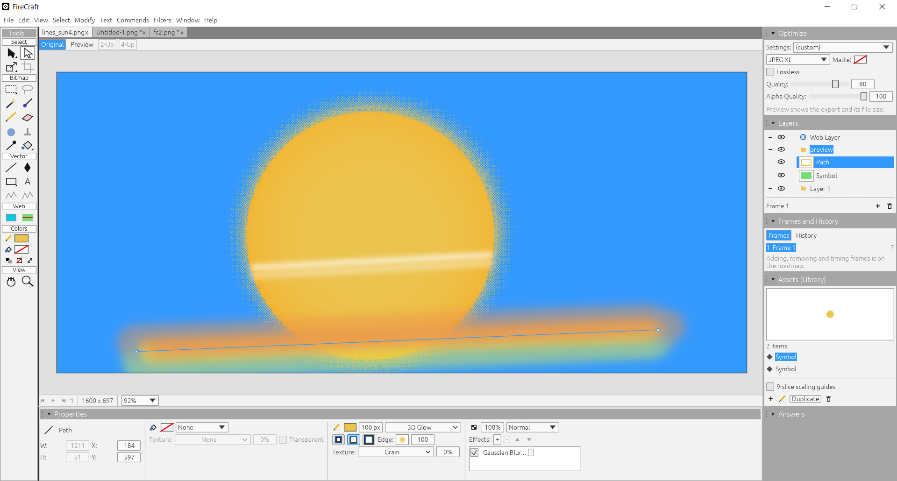

# FireCraft

FireCraft is an open-source web and screen graphics editor in the spirit of **Macromedia Fireworks MX**:
bitmap and vector editing in one document, a context-sensitive Property inspector, layers, frames and
the Fireworks PNG file format. It is written in pure Rust with egui, the same stack as the
[Craft apps](https://getartcraft.com/apps) (PhotoCraft, VectorCraft, ...), and runs natively on Windows
and Linux (macOS should work too) and in the browser via WebAssembly.


<p align="center">
  
</p>


> FireCraft is an independent, clean-room project. It contains no Macromedia/Adobe code or artwork.
> Fireworks is a trademark of Adobe. Behavior is learned from documentation and by measuring the
> original program (see [docs/clean-room.md](docs/clean-room.md)).

## Try it

- **In your browser**, nothing to install: **https://andrewjp33.github.io/firecraft/**
- **Windows and Linux**: download the latest build from
  [Releases](https://github.com/andrewjp33/firecraft/releases/latest), extract it and run
  `firecraft.exe` or `./firecraft`. On Windows, SmartScreen may say it "protected your PC" from an
  Unknown publisher. If this happens, click *More info → Run anyway*.

Or [build it from source](#build-and-run).

## Status (November 2026)

FireCraft opens, edits and saves real Fireworks documents, and draws most of them very close to how
Fireworks MX does. It is in active development. Vector and bitmap editing, text, fills, strokes, effects,
symbols, opening common image formats and exporting (the Optimize panel: GIF, JPEG, PNG, WebP, JPEG XL)
are in place. Frame editing, slices and some tools are not yet ([what's next](#not-done-yet)).

**Rendering parity** on 81 Fireworks reference files, scored against Fireworks' own render of each
file (10 November 2026): 39 match 100%, 11 more are above 99%, 18 are between 90% and 99%, and 13 are
below 90%. The average is 94.1%. Every file survives the lossless round trip and a FireCraft save
that re-opens to the same render. Details: [docs/parity.md](docs/parity.md).

### Recently added

- **Export and the Optimize panel**: GIF and animated GIF, JPEG, PNG 8/24/32, WebP and JPEG XL,
  with a Preview tab that shows the exported file and its size
  ([docs/behavior/export.md](docs/behavior/export.md)).
  - Fireworks MX's palettes (its Windows and Macintosh tables, Web 216, Uniform: pixel for pixel
    as MX exports them), Adaptive, WebSnap, Exact, Grayscale, dither, transparency and matte, all
    measured against Fireworks MX; settings kept in the document where Fireworks MX keeps them.
  - Animated GIF with Auto Crop and Auto Difference.
  - PNG 8 keeps transparency exactly whenever the colors fit (Smoother alpha for when they don't).
  - WebP and JPEG XL with Quality and Alpha Quality; a lossless PNG optimizer (OptiPNG-style
    levels) on export.
- **Opening images**: JPEG, GIF (animations as frames), PNG, BMP, TIFF, Targa, WebP and JPEG XL,
  laid out as Fireworks MX opens them, keeping the file's resolution and its palette for re-export
  ([docs/behavior/opening-files.md](docs/behavior/opening-files.md)).
- **Adjust Color > Grayscale** (FireCraft's own): gray by perceived lightness (luminance), stored so
  Fireworks MX keeps it and shows its own desaturation.
- **Effects measured in Fireworks MX**: Glow (faint pixels, glow under semi-transparent pixels,
  anti-aliased edge), Brightness/Contrast, Convert to Alpha; effects baked into a text's stored image
  are no longer drawn twice; rectangles keep their effects in Fireworks MX.
- **Pointer**: a symbol's stroke and glow can be clicked, perspective symbols included.
- **Text**: the Text tool and the whole Text menu except spelling.
  - Fonts, size, bold/italic/underline, alignment, kerning, leading, the Text Editor.
  - Text on a path (Attach, Detach, Orientation, Reverse Direction).
  - Vertical and right-to-left text.
  - Scaled, rotated, skewed and distorted text.
  - Gradient, pattern and texture fills, and strokes on text, with *Draw fill over stroke*.
  - Convert to Paths.
  - Characters are placed exactly where Fireworks MX places them (its kerning and rounding,
    measured in MX).
  - Missing fonts can keep Fireworks' saved appearance.
  - On the web, installed fonts can be used with the browser's permission.
  ([docs/behavior/text.md](docs/behavior/text.md))
- **Fills**: gradient editing with stops, opacity and presets; handles on the canvas; the
  Gradient tool; Pattern and Web Dither fills; fill textures; Hard, Anti-Alias and Feather edges
  ([docs/behavior/gradients.md](docs/behavior/gradients.md)).
- **Strokes**: Fireworks' own brush engine with its 54 presets, stroke textures, placement, the
  Edit Stroke dialog, and Fireworks CS-style stroke controls
  ([docs/behavior/strokes.md](docs/behavior/strokes.md)).
- **Painting**: Brush, Pencil, Eraser and Paint Bucket, using Fireworks' brush tips and
  sensitivities ([docs/behavior/painting.md](docs/behavior/painting.md)).
- **Pen tool** with Fireworks MX's curve drawing and point editing; Subselection improvements.
- **Perspective symbols**: a per-document choice between drawing them as Fireworks MX does or
  pixel-correct ([docs/behavior/symbols.md](docs/behavior/symbols.md)).
  - Fireworks MX mode maps each object, then applies its effects at canvas size.
  - Strokes keep their width under perspective.
  - Fill textures stay anchored to the canvas, as Fireworks MX draws them.
- **Effects accuracy**: Gaussian Blur computed as Fireworks computes it, Fireworks'
  triangle-filter softness for shadows and glows, and smooth bevel edges.
- **Strokes**: random multi-tip brushes (Outline) color their tips as Fireworks MX does.
- **Tools panel** color boxes follow the selection, text included; tool keys for Paint
  Bucket/Gradient (G), Eraser (E) and Pencil (Y). Fields with mixed values across the selection
  show blank, as in Fireworks MX.
- **History**: every drag is one undo step, recorded on mouse up, as in Fireworks MX.
- **Web**: real file pickers for Open, Save and Export; Fonts, Textures and Patterns folders;
  Ctrl+Alt+N/W/T alternatives for shortcuts the browser keeps for itself.

### Working today

- **Fireworks PNG** read and write, verified against real Fireworks MX (and also more modern Fireworks versions).
  Re-saved Fireworks files and new documents open in Fireworks MX with their
  layers, frames, bitmaps, paths, text, groups, masks, symbols and effects
  ([docs/fireworks-png.md](docs/fireworks-png.md)). Anything FireCraft doesn't model yet
  (slices, presets) is carried through a save untouched.
- **Optimize panel and Export**: GIF, animated GIF, JPEG, PNG 8/24/32 with Fireworks MX's palettes
  (Adaptive, WebSnap, Web 216, Exact, Windows, Macintosh, Grayscale, Uniform), dither and
  transparency, Auto Crop/Auto Difference for animations, kept in the document as Fireworks MX
  keeps them; plus **WebP** and **JPEG XL** with Quality and Alpha Quality, exact alpha with the
  Exact palette and a lossless **PNG optimizer** (OptiPNG-style levels). The Preview tab shows the export and its
  file size
  ([docs/behavior/export.md](docs/behavior/export.md)).
- **Opening images**: PNG, JPEG, GIF, BMP, TIFF, Targa, WebP and JPEG XL open as Fireworks MX
  opens them (a Background layer with the image; animated GIFs, WebPs and PNGs as frames;
  the file's resolution kept). Saving never overwrites the original: it asks for a `.png` name
  ([docs/behavior/opening-files.md](docs/behavior/opening-files.md)).
- **Rendering**:
  - Blend modes and all 11 MX gradient types.
  - Masks, symbol instances (with perspective) and animation frames.
  - Text with Fireworks MX's layout.
  - Live Effects: Gaussian/Motion/Radial Blur, Drop Shadow, Glow, Inner Glow, Bevels and
    Embosses, Hue/Saturation, Brightness/Contrast, Levels, Curves, Convert to Alpha and more, plus
    FireCraft's Grayscale.
  - Built-in versions of the bundled Eye Candy 4000 LE / Splat LE filters.
- **Workspace** in the style of Fireworks MX:
  - Menus, a sectioned Tools panel with press-and-hold flyouts, the Property inspector, Layers,
    Frames/History and the Library.
  - Document windows (move, resize from any edge, minimize/maximize, Cascade/Tile), or
    **documents in tabs**.
- **Tools** ([docs/behavior/paths.md](docs/behavior/paths.md)):
  - Selection: Pointer, Select Behind, **Subselection** (points of paths, members inside
    groups).
  - Transform: Scale, Skew, Distort and rotate (live preview), the **9-slice Scaling tool**
    from Fireworks CS5.
  - Bitmap: Marquee, Oval Marquee, Magic Wand (Fireworks MX's anti-alias, or a smoother one
    by default: [docs/behavior/magic-wand.md](docs/behavior/magic-wand.md)), Brush, Pencil,
    Eraser, Paint Bucket, Gradient.
  - Vector: Line, **Pen**, Rectangle (Fireworks rectangle primitives with roundness), Ellipse,
    **Text**.
  - Eyedropper, Hand, Zoom.
- **Objects** ([docs/behavior/objects.md](docs/behavior/objects.md)):
  - Cut/Copy/Paste, including **between FireCraft and Fireworks** (Windows, and Linux through
    Wine).
  - Duplicate/Clone, Group/Ungroup, Arrange, Align, Rotate/Flip, Numeric Transform.
  - Names, per-object show/hide and **lock** (from Fireworks CS).
  - Layers panel reordering by drag; Select > Superselect/Subselect.
- **Live Effects editor** in the Property inspector, with live preview, OK/Cancel and fine
  sliders ([docs/behavior/effects.md](docs/behavior/effects.md)).
- **Symbols** ([docs/behavior/symbols.md](docs/behavior/symbols.md)):
  - Convert to Symbol, Library panel, Break Apart.
  - Symbol Editor, nested editors included, with live updates and a Done button.
  - **9-slice symbols** from Fireworks CS that keep their slices under any transform.
- **Edit and document**:
  - Edit > Insert > Bitmap via Cut/Copy.
  - Select All, Deselect, Select Inverse, Feather.
  - Canvas Size and Canvas Color.
  - Layers: new, delete, show/hide, lock.
  - Undo/redo (100 steps by default, up to 999 in Preferences) with a History panel.
  - Animation playback, drag-and-drop open, opening files given on the command line.
- **Preferences**:
  - Live dragging ("Show objects while moving them", off for slower PCs).
  - Tool cursor style.
  - Color math for new documents: Precise (default) or Fireworks MX's exact formulas.
  - Perspective symbols in new documents: pixel-correct (default) or drawn as Fireworks MX does.
  - Fonts, Textures and Patterns folders.

### Not done yet

From [docs/roadmap.md](docs/roadmap.md), roughly in order:
- Combine/Alter Path, Knife, Polygon/Star.
- Crop and Lasso tools.
- Blur, Sharpen, Dodge, Burn, Smudge and Rubber Stamp.
- Export: 2-Up/4-Up previews, GIF loss, custom palettes, animated WebP; WebP and the PNG
  optimizer in the browser version; 16-bit (PNG 64) export, which needs a 16-bit pipeline.
- Editing frames (adding, removing, timing).
- Slices, hotspots and HTML export.
- Styles and the Filters menu.
- `.jsf` commands.
- Opening/importing Photoshop (PSD) files first, then Illustrator (AI) and FreeHand (FH); File >
  Import.
- Check Spelling, last.

### File compatibility

Every save is a **Fireworks MX PNG file** that **more modern Fireworks CS5 and CS6 read as well**.
Features MX doesn't have are baked into ordinary objects or stored in data MX safely ignores.
Features from the CS versions are written the way Fireworks CS writes them, so they're forward
compatible: **9-slice symbol guides** and **per-object locks** open in Fireworks CS as its own,
while Fireworks MX opens the same file without them. The one exception is a skewed or perspective
9-slice instance, which Fireworks CS can't make: FireCraft keeps its guides where CS doesn't look,
so CS opens the file with 9-slice off for that symbol instead of hanging
([docs/fireworks-png.md](docs/fireworks-png.md#compatibility-levels-design)).

New documents use FireCraft's improved drawing by default: *Precise* color math and
*Pixel-correct* perspective symbols (both can be changed in Preferences, and per document in the
Property inspector). Files from Fireworks open in the Fireworks MX modes, so they look as they
were saved. A FireCraft file keeps its modes in data Fireworks ignores, so Fireworks MX draws it
with its own rules, which can differ slightly from FireCraft's improved modes. If Fireworks MX
re-saves the file, it drops that data (and FireCraft's WebP/JPEG XL export settings): the file then
opens in FireCraft in the Fireworks MX modes. Effects are kept whole, including FireCraft's
Grayscale, which Fireworks MX shows as its own desaturation
([docs/fireworks-png.md](docs/fireworks-png.md#data-that-survives-a-fireworks-mx-re-save-tested-2026-11-10)).

Some pieces are adapted from [FirePixel](https://github.com/Zignixx/firepixel) (Apache-2.0); see
[ATTRIBUTION.md](ATTRIBUTION.md).

## Build and run

Requires Rust 1.95+ (edition 2024). The Makefile wraps the common commands (`make help`):

```sh
make              # Linux + Windows debug builds -> dist/linux/firecraft, dist/windows/firecraft.exe
make build        # Linux debug build only
make run FILE=x.png
make windows      # Windows .exe only (needs: sudo apt install mingw-w64)
make windows-msvc # Windows .exe with the MSVC toolchain, as the downloads (cargo-xwin, see below)
make test         # all tests
make parity       # compare renders with Fireworks for ../ref_fw_images; results in ../parity_runs
make web-debug    # web build (unoptimized, with debug info) -> dist/web
make web          # web build, optimized
make clean        # remove FireCraft's own build outputs; compiled dependencies stay (fast rebuild)
make distclean    # remove everything (the next build compiles all dependencies again)
make size         # disk used by target/ and dist/
```

WebP export (libwebp) and the PNG optimizer (libdeflate) compile C code: the Linux build uses the
system C compiler, `make windows` the mingw one and `make windows-msvc` clang-cl; the browser
build leaves them out.

Finished binaries are copied to `dist/` (release builds: `dist/linux-release/`,
`dist/windows-release/`; web: `dist/web/`). Cargo's `target/` holds the compiled dependencies,
which rarely change: `make clean` keeps them, so a rebuild takes seconds rather than minutes.
With [sccache](https://github.com/mozilla/sccache) installed, the Makefile uses it
automatically and compiled dependencies survive even `make distclean`.

Or with cargo directly:

```sh
cargo run --release -p firecraft -- [file.png ...]     # desktop
cargo test                                             # all crates
```

Web build (needs [trunk](https://trunkrs.dev) and the `wasm32-unknown-unknown` target):

```sh
rustup target add wasm32-unknown-unknown
cd apps/firecraft-web && trunk serve        # http://127.0.0.1:8766
```

Windows: `cargo build -p firecraft` on Windows (MSVC toolchain), or cross-compile from Linux:

```sh
sudo apt install mingw-w64          # once
make windows                        # -> dist/windows/firecraft.exe
```

The release downloads are built with the MSVC toolchain on Windows (the release workflow):
antivirus heuristics flag MinGW-built programs more often. To build the same way from Linux:

```sh
sudo apt install clang lld llvm                 # once: clang-cl, lld-link, llvm-rc
cargo install --locked cargo-xwin               # once; downloads Microsoft's SDK libraries on first use
make windows-msvc                               # -> dist/windows-msvc/firecraft.exe
```

Both Windows builds embed version information and an application manifest
(`apps/firecraft/build.rs`, `apps/firecraft/windows/firecraft.manifest`).

Startup: a small software-drawn splash shows (at least 2 s) while the GPU renderer starts
(`FIRECRAFT_NO_SPLASH=1` disables it). Renderer: wgpu on Vulkan/DX12/Metal; if the only such
device is a software rasterizer (e.g. VirtualBox) FireCraft uses OpenGL (glow), which can still use
the GPU. Force one with `FIRECRAFT_RENDERER=glow` or `FIRECRAFT_RENDERER=wgpu`.

## Layout

```text
crates/
  fwpng      L0  Fireworks PNG container: chunks, tagged document tree, pixel tiles (no deps)
  raster     L0  pixels, masks, magic wand, marquees, feather, vector rasterization
  stroke     L0  Fireworks' brush engine (adapted from FirePixel, Apache-2.0)
  text       L0  fonts, layout and rasterizing with Fireworks MX's rules (adapted from FirePixel)
  doc        L1  document model: canvas, layers, frames, bitmap/path/text/group elements
  io         L2  Document <-> Fireworks PNG; opening images; export (GIF, JPEG, PNG, WebP, JPEG XL)
  engine     L3  session, tools, selection, commands, undo history
  sysclip    --  system clipboard ("PNG" format shared with Fireworks): X11 and Win32
  ui-egui    L4  the Fireworks-style workspace (egui); only talks to engine
apps/
  firecraft       desktop app (eframe)
  firecraft-web   browser app (eframe + trunk)
tools/fwmx-oracle  scripts that measure the original Fireworks MX under Wine, and UI test
                   helpers that drive FireCraft (ui_session.sh, uimap.py, xin.py)
tools/fwcs6-oracle Fireworks CS6 under Wine for file-compatibility checks (cs6_inspect.sh,
                   cs6_launch.sh with a mouse-drag fix for Wine)
```

## AI and agent usage

- **AI-assisted**: FireCraft's code and documentation are written with the assistance of AI coding
  agents.
- **Human oversight**: People are responsible for reviewing, testing and validating everything
  made with AI tools and agents.

## License

MIT ([LICENSE-MIT](LICENSE-MIT)) or Apache-2.0 ([LICENSE-APACHE](LICENSE-APACHE)), at your option.
