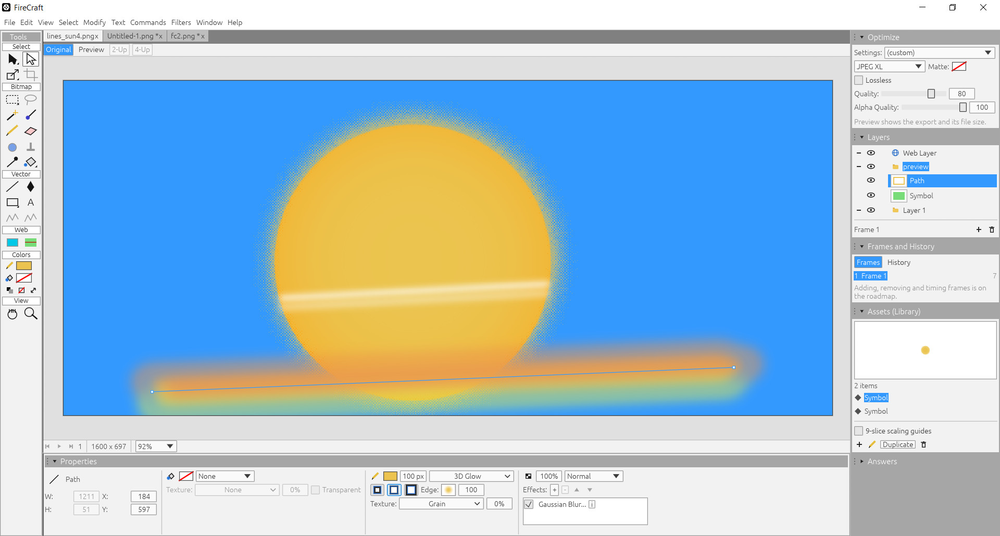

# FireCraft

FireCraft is an open-source web and screen graphics editor in the spirit of **Macromedia Fireworks MX**:
bitmap and vector editing in one document, a context-sensitive Property inspector, layers, frames and
the Fireworks PNG file format. It is written in pure Rust with egui, the same stack as the
[Craft apps](https://getartcraft.com/apps) (PhotoCraft, VectorCraft, ...), and runs natively on Windows,
macOS and Linux and in the browser via WebAssembly.


<p align="center">
  
</p>


> FireCraft is an independent, clean-room project. It contains no Macromedia/Adobe code or artwork.
> Fireworks is a trademark of Adobe. Behavior is learned from documentation and by measuring the
> original program (see [docs/clean-room.md](docs/clean-room.md)).

## Try it

- **In your browser**, nothing to install: **https://andrewjp33.github.io/firecraft/**
- **Windows and Linux**: download the latest build from
  [Releases](https://github.com/andrewjp33/firecraft/releases/latest), extract it and run
  `firecraft.exe` or `./firecraft`. On Windows, SmartScreen may say it "protected your PC" from an
  Unknown publisher. If this happens, click *More info → Run anyway*.
- **macOS** (one app for Apple silicon and Intel Macs, macOS 11 or later on Apple silicon,
  10.13 or later on Intel): download the `.dmg` from
  [Releases](https://github.com/andrewjp33/firecraft/releases/latest), open it and drag FireCraft
  onto Applications. The app isn't notarized by Apple yet, so the first time you open it macOS
  says it can't check it for malicious software:
  - macOS 15 Sequoia and later: click *Done*, then open *System Settings → Privacy & Security*,
    scroll down to "FireCraft was blocked..." and click *Open Anyway*.
  - macOS 14 and earlier: Control-click (or right-click) FireCraft in Applications, choose *Open*,
    then *Open* again.

  After that it opens normally.

Or [build it from source](#build-and-run).

## Status (November 2026)

FireCraft opens, edits and saves real Fireworks documents, and draws most of them very close to how
Fireworks MX does. It is in active development. Vector and bitmap editing, text, fills, strokes, effects,
masks, symbols (animation symbols included), opening common image formats and exporting (the
Optimize panel: GIF, JPEG, PNG, WebP, JPEG XL) are in place. Frame editing, slices and some tools
are not yet ([what's next](#not-done-yet)).

**Rendering parity** on 97 Fireworks reference files, scored against Fireworks' own render of each
file (27 November 2026): 45 match 100%, 9 more are above 99%, 33 are between 90% and 99%, and 10 are
below 90%. The average is 95.3%. Every file survives the lossless round trip and a FireCraft save
that re-opens to the same render. Details: [docs/parity.md](docs/parity.md).

### New in 0.4.0

- **Themes**: Classic (Fireworks MX's look), Classic Dark, Modern (the new default) and Modern
  Dark, following the system's dark mode.
- **Tool cursors** for every tool, drawn like Fireworks MX's.
- **Selections**: the Marquee's Fixed Ratio and Fixed Size styles, and Fireworks CS's Live marquee.
- **Whole-pixel editing**, sub-pixel with Ctrl.
- **File > Open Recent and Revert**; tool and effect settings kept between sessions.

The full list is in the release notes.

### Only in FireCraft

Things no version of Fireworks has:

- **Runs anywhere**: natively on Windows, macOS and Linux, and **in the browser** with nothing to install.
- **Better drawing, by choice**: *Precise* color math (Fireworks MX's formulas computed at full
  precision, rounded once instead of at every step) and *pixel-correct* perspective symbols
  (strokes keep their width, nothing smears), the defaults for new documents. Fireworks
  documents open in Fireworks MX's own modes, so they look as they were saved.
- **9-slice symbols that keep their slices under any transform**: rotated, skewed, distorted or
  in perspective ([docs/behavior/nine-slice.md](docs/behavior/nine-slice.md)).
- **More formats**: open and export **WebP** and **JPEG XL**; animated WebPs and PNGs open as
  frames; a lossless **PNG optimizer** (OptiPNG-style levels) on export.
- **Better exports**: PNG 8 keeps transparency exactly whenever the colors fit (*Smoother alpha*
  for when they don't); **Maximize colors per frame** for animated GIFs, with each frame's
  best-fitting colors.
- **Adjust Color > Grayscale** by human perceived lightness (luminance), kept in the file so Fireworks MX
  shows its own desaturation ([docs/behavior/effects.md](docs/behavior/effects.md)).
- **Magic Wand with a smooth edge** at any tolerance (Fireworks MX's own edge is still an option)
  ([docs/behavior/magic-wand.md](docs/behavior/magic-wand.md)).
- **Masks you can work inside**: in the Layers panel, open a mask to see its mask and the
  objects it masks; select, rename and reorder them, drag objects into or out of a mask, and
  Group, Ungroup, Convert to Symbol or Break Apart right there
  ([docs/behavior/masks.md](docs/behavior/masks.md)).
- **Small things that add up**:
  - Ctrl + mouse wheel (or a trackpad pinch) zooms smoothly around the pointer, with any tool.
  - The frame number under the canvas is editable: type a frame and press Enter.
  - Dragging an animation's motion path moves the animation along live (Fireworks MX moves it on
    mouse up).
  - UI Scale: the whole interface can be shown at 50-200% of the system's display scaling, and
    follows each monitor's DPI.
  - The system's own cursors for the tools, if you prefer them to FireCraft's.
  - Four themes (Edit > Preferences or View > Theme): Classic (Fireworks MX's look), Classic
    Dark, Modern (rounded cards, soft gradients, a dark tool sidebar; the default) and Modern
    Dark. "Read dark mode from system" (on by default) picks the light or dark version as the
    system's dark mode is, and follows it when it changes (Windows, macOS, browsers, and Linux
    desktops through the XDG portal, GNOME's setting or the GTK theme). Any accent color, with
    text on it turning black when the color is light. Documents look the same in all of them.

### Working today

- **Fireworks PNG** read and write, verified against real Fireworks MX (and also more modern Fireworks versions).
  Re-saved Fireworks files and new documents open in Fireworks MX with their
  layers, frames, bitmaps, paths, text, groups, masks, symbols and effects
  ([docs/fireworks-png.md](docs/fireworks-png.md)). Anything FireCraft doesn't model yet
  (slices, presets) is carried through a save untouched.
- **Optimize panel and Export**: GIF, animated GIF, JPEG, PNG 8/24/32 with Fireworks MX's palettes
  (Adaptive, WebSnap, Web 216, Exact, Windows, Macintosh, Grayscale, Uniform: the fixed ones pixel
  for pixel as Fireworks MX exports them), dither, transparency and matte, Auto Crop/Auto
  Difference for animations, kept in the document as Fireworks MX keeps them; plus **WebP** and
  **JPEG XL** with Quality and Alpha Quality, and a lossless **PNG optimizer**. The Preview tab
  shows the export, its file size and, for animations, the current frame. The **color table**
  shows the palette and edits it as Fireworks MX's does (edit, lock, make transparent, snap to web
  safe, add and delete colors; custom palettes; Load/Save Palette as `.act`), saved in the document
  so Fireworks MX reads the same table ([docs/behavior/export.md](docs/behavior/export.md#the-color-table)).
- **Opening images**: PNG, JPEG, GIF, BMP, TIFF, Targa, WebP and JPEG XL open as Fireworks MX
  opens them (a Background layer with the image; animated GIFs, WebPs and PNGs as frames;
  the file's resolution and palette kept for re-export). Saving never overwrites the original: it
  asks for a `.png` name; **File > Open Recent** lists the last 10 files, as Fireworks MX does,
  and **File > Revert** goes back to the saved file
  ([docs/behavior/opening-files.md](docs/behavior/opening-files.md)).
- **Masks**: vector and bitmap masks render as in Fireworks MX and can be made and edited with all
  of Fireworks MX's mask commands, from the Layers panel and the Property inspector
  ([docs/behavior/masks.md](docs/behavior/masks.md)).
- **Rendering**:
  - Blend modes and all 11 MX gradient types.
  - Masks, symbol instances (with perspective), animation symbols and animation frames.
  - Text with Fireworks MX's layout.
  - Live Effects: Gaussian/Motion/Radial Blur, Drop Shadow, Glow, Inner Glow, Bevels and
    Embosses, Hue/Saturation, Brightness/Contrast, Levels, Curves, Convert to Alpha and more,
    measured against Fireworks MX (Gaussian Blur computed as Fireworks computes it, its
    triangle-filter softness for shadows and glows); plus FireCraft's Grayscale.
  - The **Filters menu** with Fireworks MX's classic filters, and built-in versions of the bundled
    Eye Candy 4000 LE / Splat LE filters.
- **Text** ([docs/behavior/text.md](docs/behavior/text.md)): the Text tool and the whole Text
  menu except spelling.
  - Fonts, size, bold/italic/underline, alignment, kerning, leading, the Text Editor.
  - Text on a path (Attach, Detach, Orientation, Reverse Direction); vertical and right-to-left
    text; scaled, rotated, skewed and distorted text.
  - Gradient, pattern and texture fills, and strokes on text, with *Draw fill over stroke*;
    Convert to Paths.
  - Characters placed exactly where Fireworks MX places them (its kerning and rounding).
  - Missing fonts can keep Fireworks' saved appearance; on the web, installed fonts can be used
    with the browser's permission.
- **Fills** ([docs/behavior/gradients.md](docs/behavior/gradients.md)): gradient editing with stops,
  opacity and presets, handles on the canvas, the Gradient tool; Pattern and Web Dither fills;
  fill textures; Hard, Anti-Alias and Feather edges.
- **Strokes** ([docs/behavior/strokes.md](docs/behavior/strokes.md)): Fireworks' own brush engine
  with its 54 presets (random multi-tip brushes included), stroke textures, placement, the Edit
  Stroke dialog, and Fireworks CS-style stroke controls.
- **Workspace** in the style of Fireworks MX:
  - Menus, a sectioned Tools panel with press-and-hold flyouts, the Property inspector, Layers,
    Frames/History and the Library.
  - Document windows (move, resize from any edge, minimize/maximize, Cascade/Tile), or
    **documents in tabs**.
  - The Tools panel's color boxes follow the selection, text included; fields with mixed values
    across the selection show blank, as in Fireworks MX.
  - Cursors for every tool, drawn like Fireworks MX's; tool options and each effect's settings
    kept between sessions.
- **Tools** ([docs/behavior/paths.md](docs/behavior/paths.md)):
  - Selection: Pointer (click a symbol's stroke or glow; drag a band on empty canvas; Alt+drag
    duplicates), Select Behind, **Subselection** (points of paths, members inside groups, masks;
    double-click opens a symbol).
  - Transform: Scale, Skew, Distort and rotate (live preview), the **9-slice Scaling tool**
    from Fireworks CS5, the **Crop tool**.
  - Bitmap: Marquee, Oval Marquee, Magic Wand, Brush, Pencil, Eraser, Paint Bucket, Gradient,
    with Fireworks' brush tips and sensitivities
    ([docs/behavior/painting.md](docs/behavior/painting.md)).
  - Vector: Line, **Pen** (Fireworks MX's curve drawing and point editing), Rectangle (Fireworks
    rectangle primitives with roundness), Ellipse, **Text**; Fireworks' Shift and Alt handle
    controls in the Pen and Subselection tools.
  - Eyedropper, Hand, Zoom; tool keys as in Fireworks (G, E, Y...).
- **Bitmap editing** ([docs/behavior/selection.md](docs/behavior/selection.md)): bitmap mode
  (double-click, Exit Bitmap Mode), marquees that stay across bitmaps, the Marquee's Normal,
  Fixed Ratio and Fixed Size styles, Live marquee (Fireworks CS), Delete, Feather, Select
  Inverse, Edit > Insert > Bitmap via Cut/Copy and Empty Bitmap, New Bitmap Image, filling or
  painting a marquee on empty canvas into a new bitmap.
- **Objects** ([docs/behavior/objects.md](docs/behavior/objects.md)):
  - Cut/Copy/Paste, including **between FireCraft and Fireworks** (Windows, and Linux through
    Wine).
  - Duplicate/Clone, Group/Ungroup, Arrange, Align (and the Align panel), Rotate/Flip, Numeric
    Transform.
  - Moves, shapes and transforms on whole pixels (Ctrl: sub-pixel); W/H/X/Y in the Property
    inspector.
  - Names, per-object show/hide and **lock** (from Fireworks CS).
  - Layers panel with thumbnails, reordering by drag, and objects inside groups and masks;
    Select > Superselect/Subselect; a right-click menu on the canvas.
  - Paste pictures from other applications; File > New from the clipboard.
- **Live Effects editor** in the Property inspector, with live preview, OK/Cancel and fine
  sliders ([docs/behavior/effects.md](docs/behavior/effects.md)).
- **Symbols** ([docs/behavior/symbols.md](docs/behavior/symbols.md)):
  - Convert to Symbol, Library panel, Break Apart.
  - Symbol Editor, nested editors included, with live updates and a Done button.
  - **Animation symbols**: Modify > Animation, the Animate dialog, Property inspector fields and
    a draggable motion path.
  - **9-slice symbols** from Fireworks CS that keep their slices under any transform.
  - **Perspective symbols**, drawn as Fireworks MX draws them (each object mapped, effects at
    canvas size, fill textures anchored to the canvas) or pixel-correct.
- **Edit and document**:
  - Select All, Deselect, Canvas Size (anchors, units), Image Size, Canvas Color, Crop Document
    and Crop Selected Bitmap.
  - Layers: new, delete, show/hide, lock.
  - Undo/redo (100 steps by default, up to 999 in Preferences) with a History panel; every drag
    is one undo step, recorded on mouse up, as in Fireworks MX.
  - Animation playback with first/previous/next/last frame and a frame number to type into;
    drag-and-drop open; opening files given on the command line.
- **Preferences**:
  - UI Scale, 50-200% on top of the system's display scaling (`--ui-scale` overrides it at launch).
  - Theme: Classic, Classic Dark, Modern, Modern Dark, Read dark mode from system (also under
    View > Theme), and the accent color.
  - Live dragging ("Show objects while moving them", off for slower PCs).
  - Tool cursor style.
  - Color math for new documents: Precise (default) or Fireworks MX's exact formulas.
  - Perspective symbols in new documents: pixel-correct (default) or drawn as Fireworks MX does.
  - Fonts, Textures and Patterns folders.
- **Web version** (back to Safari 13): real file pickers for Open, Save and Export; Fonts, Textures and Patterns
  folders; Ctrl+Alt+N/W/T alternatives for shortcuts the browser keeps for itself.

### Not done yet

From [docs/roadmap.md](docs/roadmap.md), roughly in order:
- Combine/Alter Path, Knife, Polygon/Star.
- Lasso and Polygon Lasso tools.
- Blur, Sharpen, Dodge, Burn, Smudge and Rubber Stamp.
- Export: 2-Up/4-Up previews, GIF loss, animated WebP; WebP and the PNG
  optimizer in the browser version; 16-bit (PNG 64) export, which needs a 16-bit pipeline.
- Editing frames (adding, removing, timing) in the Frames panel.
- Slices, hotspots and HTML export.
- Styles.
- `.jsf` commands.
- Opening/importing Photoshop (PSD) files first, then Illustrator (AI) and FreeHand (FH); File >
  Import.
- Check Spelling, last.

### File compatibility

Every save is a **Fireworks MX PNG file** that **more modern Fireworks CS5 and CS6 read as well**.
Features MX doesn't have are baked into ordinary objects or stored in data MX safely ignores.
Features from the CS versions are written the way Fireworks CS writes them, so they're forward
compatible: **9-slice symbol guides** and **per-object locks** open in Fireworks CS as its own,
while Fireworks MX opens the same file without them. The one exception is a skewed or perspective
9-slice instance, which Fireworks CS can't make: FireCraft keeps its guides where CS doesn't look,
so CS opens the file with 9-slice off for that symbol instead of hanging
([docs/fireworks-png.md](docs/fireworks-png.md#compatibility-levels-design)).

New documents use FireCraft's improved drawing by default: *Precise* color math and
*Pixel-correct* perspective symbols (both can be changed in Preferences, and per document in the
Property inspector). Files from Fireworks open in the Fireworks MX modes, so they look as they
were saved. A FireCraft file keeps its modes in data Fireworks ignores, so Fireworks MX draws it
with its own rules, which can differ slightly from FireCraft's improved modes. If Fireworks MX
re-saves the file, it drops that data (and FireCraft's WebP/JPEG XL export settings): the file then
opens in FireCraft in the Fireworks MX modes. Effects are kept whole, including FireCraft's
Grayscale, which Fireworks MX shows as its own desaturation
([docs/fireworks-png.md](docs/fireworks-png.md#data-that-survives-a-fireworks-mx-re-save-tested-2026-11-10)).

Some pieces are adapted from [FirePixel](https://github.com/Zignixx/firepixel) (Apache-2.0); see
[ATTRIBUTION.md](ATTRIBUTION.md).

## Build and run

Requires Rust 1.95+ (edition 2024). The Makefile wraps the common commands (`make help`):

```sh
make              # Linux + Windows debug builds -> dist/linux/firecraft, dist/windows/firecraft.exe
make build        # Linux debug build only
make run FILE=x.png
make windows      # Windows .exe only (needs: sudo apt install mingw-w64)
make windows-msvc # Windows .exe with the MSVC toolchain, as the downloads (cargo-xwin, see below)
make macos        # macOS app (on a Mac; see below). make check-macos checks it compiles, from Linux
make test         # all tests
make parity       # compare renders with Fireworks for ../ref_fw_images; results in ../parity_runs
make web-debug    # web build (unoptimized, with debug info) -> dist/web
make web          # web build, optimized
make clean        # remove FireCraft's own build outputs; compiled dependencies stay (fast rebuild)
make distclean    # remove everything (the next build compiles all dependencies again)
make size         # disk used by target/ and dist/
```

WebP export (libwebp) and the PNG optimizer (libdeflate) compile C code: the Linux build uses the
system C compiler, `make windows` the mingw one and `make windows-msvc` clang-cl; the browser
build leaves them out.

Finished binaries are copied to `dist/` (release builds: `dist/linux-release/`,
`dist/windows-release/`, `dist/macos-release/`; web: `dist/web/`). Cargo's `target/` holds the compiled dependencies,
which rarely change: `make clean` keeps them, so a rebuild takes seconds rather than minutes.
With [sccache](https://github.com/mozilla/sccache) installed, the Makefile uses it
automatically and compiled dependencies survive even `make distclean`.

Or with cargo directly:

```sh
cargo run --release -p firecraft -- [file.png ...]     # desktop
cargo test                                             # all crates
```

Web build (needs [trunk](https://trunkrs.dev), the `wasm32-unknown-unknown` target, the Rust
source and Node.js). There are two builds, and the page loads whichever the browser can run:
the modern one, and a slower one for browsers back to Safari 13 (the standard library rebuilt
as plain WebAssembly, the JavaScript rewritten for older browsers). The Makefile sets that up,
so build through it rather than with `trunk` directly:

```sh
rustup target add wasm32-unknown-unknown
rustup component add rust-src
make web-serve                              # http://127.0.0.1:8766
```

Windows: `cargo build -p firecraft` on Windows (MSVC toolchain), or cross-compile from Linux:

```sh
sudo apt install mingw-w64          # once
make windows                        # -> dist/windows/firecraft.exe
```

The release downloads are built with the MSVC toolchain on Windows (the release workflow):
antivirus heuristics flag MinGW-built programs more often. To build the same way from Linux:

```sh
sudo apt install clang lld llvm                 # once: clang-cl, lld-link, llvm-rc
cargo install --locked cargo-xwin               # once; downloads Microsoft's SDK libraries on first use
make windows-msvc                               # -> dist/windows-msvc/firecraft.exe
```

Both Windows builds embed version information and an application manifest
(`apps/firecraft/build.rs`, `apps/firecraft/windows/firecraft.manifest`).

macOS: on a Mac with the Xcode command line tools (`xcode-select --install`):

```sh
make macos                 # -> dist/macos/FireCraft.app, debug, this Mac's architecture
make macos-release         # -> dist/macos-release/FireCraft.app, universal (Apple silicon + Intel)
make macos-release ARCH=arm64      # or x86_64: one architecture only
scripts/package-release.sh macos 0.3.0   # -> dist/packages/firecraft-0.3.0-macos-universal.dmg
```

The app is signed ad hoc (Apple silicon Macs run only signed code). With a Developer ID
certificate, `MACOS_SIGN_IDENTITY="Developer ID Application: ..." make macos-release` signs with
it, and `scripts/package-release.sh` then notarizes the disk image if given an App Store Connect API
key (see the scripts; the release workflow does the same from repository secrets, see
`scripts/macos-ci-signing.sh`). Linking needs Apple's SDK, so there is no cross-build from Linux,
but `make check-macos` (part of `make check`) checks on Linux that the code compiles for macOS.
When started from the Finder, log messages go to `~/Library/Logs/FireCraft.log`.

Startup: a small software-drawn splash shows (at least 2 s) while the GPU renderer starts
(`FIRECRAFT_NO_SPLASH=1` disables it). Renderer: wgpu on Vulkan/DX12/Metal; if the only such
device is a software rasterizer (e.g. VirtualBox) FireCraft uses OpenGL (glow), which can still use
the GPU. Force one with `FIRECRAFT_RENDERER=glow` or `FIRECRAFT_RENDERER=wgpu`.

UI scale: Edit > Preferences > UI Scale (50-200%) draws the whole interface larger or smaller than
the system's display scaling; 100% follows the system, whatever the monitor's DPI. If a scale makes
the interface unusable, start FireCraft with `--ui-scale 100` (also `--ui-scale=100`, `150%` or `1.5`):
it overrides the setting for that session, so you can set it back in Preferences. In the browser
version add `?ui_scale=100` to the page address.

```sh
firecraft --ui-scale 100 [files...]
```

## Layout

```text
crates/
  fwpng      L0  Fireworks PNG container: chunks, tagged document tree, pixel tiles (no deps)
  raster     L0  pixels, masks, magic wand, marquees, feather, vector rasterization
  stroke     L0  Fireworks' brush engine (adapted from FirePixel, Apache-2.0)
  text       L0  fonts, layout and rasterizing with Fireworks MX's rules (adapted from FirePixel)
  doc        L1  document model: canvas, layers, frames, bitmap/path/text/group elements
  io         L2  Document <-> Fireworks PNG; opening images; export (GIF, JPEG, PNG, WebP, JPEG XL)
  engine     L3  session, tools, selection, commands, undo history
  sysclip    --  system clipboard ("PNG" format shared with Fireworks): X11 and Win32
  ui-egui    L4  the Fireworks-style workspace (egui); only talks to engine
apps/
  firecraft       desktop app (eframe)
  firecraft-web   browser app (eframe + trunk)
tools/fwmx-oracle  scripts that measure the original Fireworks MX under Wine, and UI test
                   helpers that drive FireCraft (ui_session.sh, uimap.py, xin.py)
tools/fwcs6-oracle Fireworks CS6 under Wine for file-compatibility checks (cs6_inspect.sh,
                   cs6_launch.sh with a mouse-drag fix for Wine)
```

## AI and agent usage

- **AI-assisted**: FireCraft's code and documentation are written with the assistance of AI coding
  agents.
- **Human oversight**: People are responsible for reviewing, testing and validating everything
  made with AI tools and agents.

## License

MIT ([LICENSE-MIT](LICENSE-MIT)) or Apache-2.0 ([LICENSE-APACHE](LICENSE-APACHE)), at your option.
